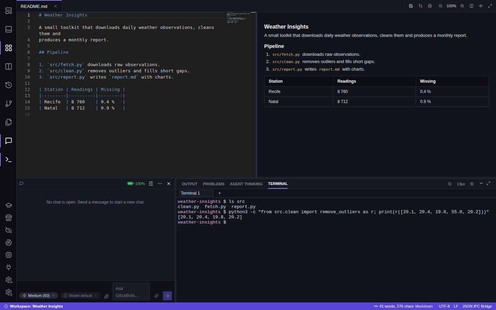
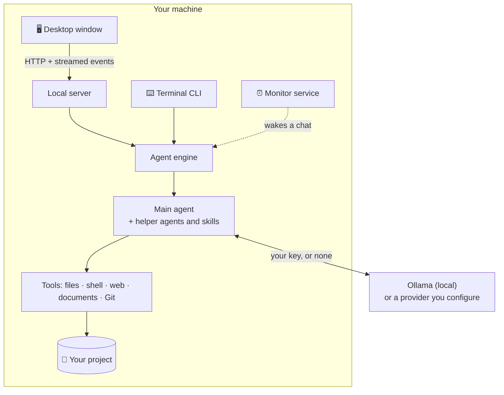
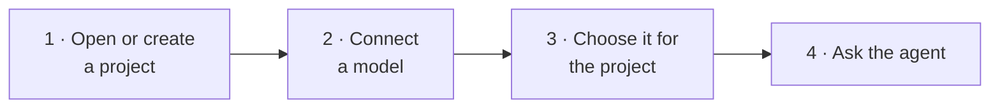
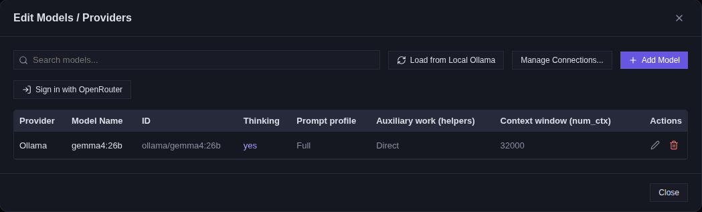
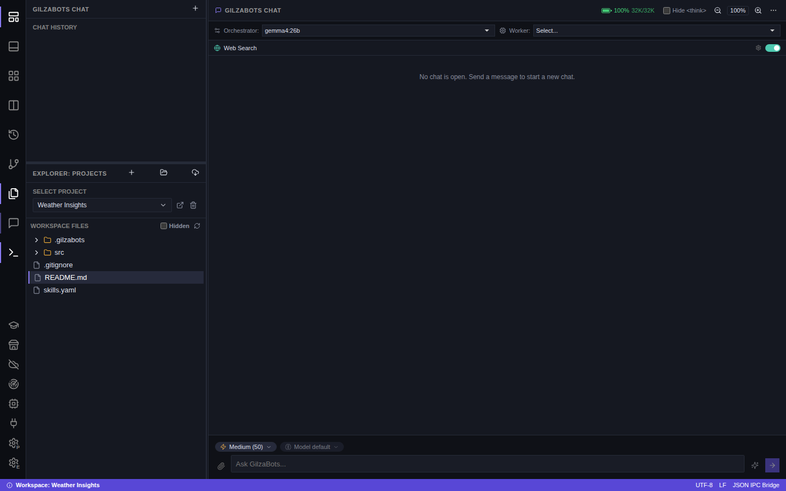
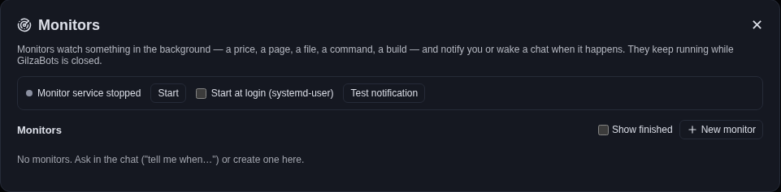
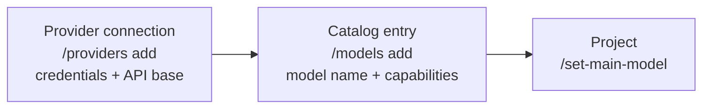

<p align="center">
  
</p>

<h1 align="center">GilzaBots</h1>

<p align="center">
  <strong>A free, open-source AI agent that works inside your projects.</strong><br>
  It reads and edits files, runs commands, searches the web, writes code and documents,<br>
  and keeps watch with background monitors, on a local model or on a provider you choose.
</p>

<p align="center">
  
  
  
  
</p>

<p align="center">
  <a href="#-install">Install</a> ·
  <a href="#-quick-start">Quick start</a> ·
  <a href="#-features">Features</a> ·
  <a href="#%EF%B8%8F-command-line-interface">CLI</a> ·
  <a href="#%EF%B8%8F-development">Development</a> ·
  <a href="#-feedback-and-bug-reports">Feedback</a>
</p>

<p align="center">
  
  <br>
  <sub>The <b>Studio</b> layout: editor and live preview on top, the agent chat and the integrated terminal below.</sub>
</p>

> [!NOTE]
> **Everything runs on your machine.** There is no account, no subscription and no telemetry.
> Use a local model through [Ollama](https://ollama.com), or bring your own API key for a third-party provider.

---

## Contents

- [Features](#-features)
- [How it works](#-how-it-works)
- [Install](#-install)
- [Quick start](#-quick-start)
- [The workspace](#%EF%B8%8F-the-workspace)
- [Monitors](#-monitors)
- [Command-line interface](#%EF%B8%8F-command-line-interface)
- [Uninstall](#%EF%B8%8F-uninstall)
- [Feedback and bug reports](#-feedback-and-bug-reports)
- [Development](#%EF%B8%8F-development)
- [Security and credentials](#-security-and-credentials)
- [Contributing](#-contributing)
- [License](#-license)

---

## ✨ Features

<table>
  <tr>
    <td width="50%" valign="top">
      <h3>🤖 An agent that does the work</h3>
      Tools for files, code search, the shell, the web and office documents, plus <b>skills</b> and <b>helper agents</b> for specialised work.
    </td>
    <td width="50%" valign="top">
      <h3>🔒 Local and private</h3>
      Local models through Ollama, or external providers configured with your own key. Your projects stay in your folders.
    </td>
  </tr>
  <tr>
    <td valign="top">
      <h3>🛡️ You stay in control</h3>
      Choose how much the agent may do on its own (<code>auto</code>, <code>edit</code> or <code>plan</code>). Agent turns are checkpointed, so changes can be reviewed and undone.
    </td>
    <td valign="top">
      <h3>⏰ Background monitors</h3>
      Watch a page, a file, a command or a timer, then notify you or wake a chat. Monitors keep running while the window is closed.
    </td>
  </tr>
  <tr>
    <td valign="top">
      <h3>🧑‍💻 A complete workspace</h3>
      Editor, terminal, Git, and Markdown, HTML and PDF previews, in several layouts.
    </td>
    <td valign="top">
      <h3>📄 LaTeX built in</h3>
      PDF preview with SyncTeX, plus local compilation with Tectonic.
    </td>
  </tr>
  <tr>
    <td valign="top">
      <h3>⌨️ Command-line interface</h3>
      The same agent, projects and skills in a terminal, with no desktop window.
    </td>
    <td valign="top">
      <h3>🌐 Bilingual interface</h3>
      English and Brazilian Portuguese.
    </td>
  </tr>
</table>

---

## 🧭 How it works

GilzaBots has **two front-ends and one agent engine**. The desktop window and the command-line interface drive the same agent. The agent works on your project folder and talks only to the model provider you configured.



The architecture and design decisions are documented in [PROJECT_DESIGN.md](PROJECT_DESIGN.md).

---

## 📦 Install

### Requirements

| Operating system | Minimum version |
|------------------|-----------------|
| 🐧 Linux         | Ubuntu 24.04 or 26.04 |
| 🪟 Windows       | Windows 10 or 11 |

The installer downloads the current GilzaBots Community release from GitHub Releases, extracts it into your user profile and creates shortcuts. It does **not** require administrator privileges.

### Linux / macOS

Open a terminal and run:

```bash
curl -fsSL https://raw.githubusercontent.com/gilzamir18/GilzaBots/main/install.sh | bash
```

<details>
<summary>Prefer to inspect the script first?</summary>

```bash
curl -fsSL https://raw.githubusercontent.com/gilzamir18/GilzaBots/main/install.sh -o install.sh
less install.sh
bash install.sh
```

</details>

| What                | Where |
|---------------------|-------|
| Application         | `~/.local/share/GilzaBots` |
| Command             | `~/.local/bin/gilzabots` (symlink) |
| Desktop launcher    | `~/.local/share/applications/gilzabots.desktop` |

### Windows

Open PowerShell and run:

```powershell
irm https://raw.githubusercontent.com/gilzamir18/GilzaBots/main/install.ps1 | iex
```

<details>
<summary>Prefer to inspect the script first?</summary>

```powershell
Invoke-WebRequest https://raw.githubusercontent.com/gilzamir18/GilzaBots/main/install.ps1 -OutFile install.ps1
Get-Content .\install.ps1
.\install.ps1
```

</details>

The application is installed under `%LOCALAPPDATA%\GilzaBots`. The installer adds its executable directory to the user `PATH` and creates shortcuts on the Desktop and in the Start menu.

### Command line only

To install the agent without the desktop window:

```bash
uv tool install gilzabots     # or: pip install gilzabots
```

The desktop application needs the `gui` extra: `pip install "gilzabots[gui]"`. LaTeX compilation uses a `tectonic` found on your `PATH`.

> [!IMPORTANT]
> **Snap installations and the integrated terminal.** The snap runs under strict confinement, so its integrated terminal cannot run programs installed on the host. There, `python` is the Python 3.12 bundled with GilzaBots. `python -m venv .venv` works, but the environment it creates is meant to be used from GilzaBots's terminal. An environment created in a system terminal will not work inside GilzaBots, because each side has a different `/usr/bin/python3`. If you need your own toolchain (your Python, TeX Live, `make`, and so on) from the terminal or the AI assistant, use the direct installer above.

---

## 🚀 Quick start



1. **Open or create a project.** A project is a folder on your disk. Use the **+** (new project) or the folder (import) button in the explorer.
2. **Connect a model.** Open **Connections and models** in the left activity bar.
   - **Ollama:** click **Load from Local Ollama** to add the models your Ollama server already has.
   - **A hosted provider:** use **Manage Connections…** to add the provider and your API key, then **Add Model**. OpenRouter can also be connected with **Sign in with OpenRouter**.
3. **Choose it for the project** in the **Orchestrator** selector at the top of the chat.
4. **Ask.** For example: *"Add unit tests for `src/clean.py` and run them"*, *"Summarise the changes since the last commit"* or *"Fix the compilation errors in chapter 3"*.

<p align="center">
  
  <br>
  <sub>The model catalog. Each model sits under a provider connection that holds its credentials.</sub>
</p>

---

## 🖥️ The workspace

The buttons at the top of the activity bar switch between layouts, so you can give the chat or the files the space they need:

| Layout | What it shows |
|--------|---------------|
| **Chat** | The conversation, with the chat history and project explorer beside it |
| **Chat with bottom panel** | The chat plus the output, problems, agent-thinking and terminal panel |
| **Studio** | Editor and preview on top, chat and terminal below (screenshot at the top of this page) |
| **Document** | The open file and its preview, side by side |
| **Review** | The changed files next to the editor, to stage, discard or restore an agent checkpoint |

<p align="center">
  
  <br>
  <sub>The <b>Chat</b> layout, with the orchestrator model and web search toggle at the top of the conversation.</sub>
</p>

The window also includes:

- **Source control:** Git status, diffs, staging and commits.
- **Previews:** Markdown, HTML and PDF.
- **LaTeX:** PDF preview with SyncTeX forward and inverse search, and local compilation with Tectonic.
- **Reading and voice tools:** PDF annotations, a PDF presentation mode, dictation in the chat, read-aloud, and translating or asking about a selected excerpt.

These editor features belong to the window and have no terminal equivalent.

---

## ⏰ Monitors

A monitor is a background watcher. You define **what** to check (a timer, a web page, a command, a file, or a question for the model), **when** to check it, and **what to do** when the condition holds: show a system notification, wake the chat that asked for it, or both.

Ask for one in the chat, for example *"tell me whenever the dollar moves 10 cents"*, or create one in the **Monitors** panel. Monitors run in a service of their own, so they keep working while GilzaBots is closed. That service can start at login.

<p align="center">
  
</p>

From a terminal, `gilzabots monitors` (or `/monitors` inside the CLI) lists and manages them.

---

## ⌨️ Command-line interface

The same agent, projects and skills, in a terminal instead of a window.

### Usage

```bash
cd my-thesis
gilzabots --cli                       # interactive session for the project in this folder
gilzabots --cli --here                # register this folder as a new project first
gilzabots --cli --project my-thesis   # pick a project by name

gilzabots -p "fix the compilation errors in chapter 3"   # one turn, then exit
echo "summarise the changes" | gilzabots -p -            # prompt from standard input
```

| While a session runs | |
|---|---|
| Streaming | The answer streams as the model writes it. Tool calls appear as `⏺ tool_name(...)` with their results, and reasoning is dimmed. |
| Quieter output | `/thoughts off` and `/tools off` |
| Interrupting | `Ctrl+C` interrupts the running turn without ending the session. What the agent had already written is kept, and `/resume` continues from there. |
| Permissions | In `edit` mode the agent asks for permission in the terminal before each change. In `plan` mode it presents the plan for approval. |
| Help | `/help` lists the commands by section with their arguments. `/help <command>` shows worked examples, such as `/help /models`, `/help /providers` or `/help /chat`. |

Beyond the commands shared with the desktop chat, the terminal adds `/chat` (list, create and switch conversations), `/effort` (this chat's reasoning effort), `/compile`, `/cost` and `/resume`.

### Registering a model

A usable model is two records: a **provider connection** that holds the credentials, and a **catalog entry** that names a model under it. Both can be managed from any text front-end.



```bash
/providers add label="Ollama Gil" provider=ollama api_base=http://192.168.0.10:11434/v1
/providers add label="OpenAI" provider=openai api_key=sk-...
/providers                                    # list connections

/models add name=gemma4:26b connection=ollama-gil num_ctx=65000 supports_thinking=true
/models list                                  # the catalog
/models show ollama/gemma4:26b
/models set ollama/gemma4:26b profile=light policy=delegate
/models remove ollama/gemma4:26b

/set-main-model ollama/gemma4:26b             # point this project at it
```

Any of these also runs as a one-shot, so a machine can be set up from a script:

```bash
gilzabots -p '/providers add label="Ollama Gil" provider=ollama api_base=http://192.168.0.10:11434/v1'
gilzabots -p '/models add name=gemma4:26b connection=ollama-gil num_ctx=65000'
```

> [!TIP]
> `/set-main-model` only stores an id. Without a catalog entry behind it there is no API base, no key and no capabilities. An unrecognised field is refused rather than guessed at, so a typo cannot become an invisible setting. To forward a parameter to the provider, write it as `extra.<name>`, for example `extra.keep_alive=30m`.

---

## 🗑️ Uninstall

Uninstalling keeps your settings, chats, caches, credentials and project directories by default. **Project directories are never removed.**

| Installation | How to uninstall |
|--------------|------------------|
| Linux / macOS (direct) | `gilzabots-uninstall`. Add `--purge` to also remove the global GilzaBots data directory. |
| Windows | **Settings › Apps › Installed apps › GilzaBots**, or **Uninstall GilzaBots** in the Start menu. The PowerShell `-Purge` switch removes global application data after confirmation. |
| Snap | `sudo snap remove gilzabots`, from a system terminal |

<details>
<summary>Older installations without an uninstall command</summary>

Linux / macOS:

```bash
curl -fsSL https://raw.githubusercontent.com/gilzamir18/GilzaBots/main/uninstall.sh | bash
```

Windows:

```powershell
irm https://raw.githubusercontent.com/gilzamir18/GilzaBots/main/uninstall.ps1 | iex
```

</details>

---

## 💬 Feedback and bug reports

- **Suggestions, criticism and feature ideas:** use the [GilzaBots feedback form](https://forms.gle/MsfYN4Yx9Cy8QNAR6), also available inside GilzaBots under **Settings › About › Send feedback (form)**.
- **Bugs:** use **Settings › About › Send feedback on GitHub**. The application opens a pre-filled issue at the [GilzaBots issue tracker](https://github.com/gilzamir18/GilzaBots/issues) with version and runtime information. Nothing is submitted automatically, so review the issue and remove private information before publishing it.

---

## 🛠️ Development

Requirements: **Python 3.11 or newer**, **Node.js/npm** and **Git**.

<details open>
<summary><b>Bash (Linux/macOS)</b></summary>

```bash
git clone https://github.com/gilzamir18/GilzaBots.git
cd GilzaBots
python3 -m venv .venv
source .venv/bin/activate
python -m pip install --upgrade pip
python -m pip install -r requirements.txt
npm install --prefix ./gui_src
npm run build --prefix ./gui_src
python main.py
```

</details>

<details>
<summary><b>PowerShell (Windows)</b></summary>

```powershell
git clone https://github.com/gilzamir18/GilzaBots.git
cd GilzaBots
python -m venv .venv
.\.venv\Scripts\Activate.ps1
python -m pip install --upgrade pip
python -m pip install -r requirements.txt
npm install --prefix .\gui_src
npm run build --prefix .\gui_src
python .\main.py
```

If script execution is disabled for the current PowerShell process, run `Set-ExecutionPolicy -Scope Process Bypass` before activating the virtual environment.

</details>

### Project layout

| Path | What lives there |
|------|------------------|
| [`gilzabots/`](gilzabots/) | Python backend: local server, agent engine, tools, CLI, monitors |
| [`agenticblocks/`](agenticblocks/) | The AgenticBlocks agent framework, first-party source in this repository |
| [`gui_src/`](gui_src/) | React/Vite desktop interface |
| [`skills/`](skills/) | Built-in agent skills |
| [`tests/`](tests/) | Test suite |
| [`docs/`](docs/) | Specifications, knowledge base and images |

### Build and test

| Task | Command |
|------|---------|
| Run the test suite (from the repository root) | `python -m pytest` |
| Rebuild only the web interface | `npm run build --prefix gui_src` |
| Packaged desktop build on Windows | `.\build_exe.ps1` |
| Packaged desktop build on Linux | `bash ./build_exe.sh` |

The build scripts install the build dependencies, build the React/Vite interface, download pinned Tectonic and Pandoc releases, and package the application with PyInstaller. Outputs are written under `dist/`.

<details>
<summary><b>Release publishing (maintainers only)</b></summary>

The `binpacking.ps1` and `binpacking.sh` scripts package an existing build and upload it over SSH. They intentionally contain no server address, username, credential or private server path. Maintainers must provide:

- `GILZABOTS_RELEASE_HOST`
- `GILZABOTS_RELEASE_USER`
- `GILZABOTS_RELEASE_DIR`

Authentication is handled by the local SSH client, preferably with an SSH key or agent. Credentials must never be committed to the repository.

</details>

---

## 🔐 Security and credentials

- API keys configured in the application are local user data and must not be committed.
- Environment files, private keys, credentials, databases, logs, build outputs and local runtime data are excluded by `.gitignore`.
- Report a suspected leaked credential privately to the maintainers. Revoke and rotate any credential that may have entered Git history: deleting it only from the latest commit is not enough.

---

## 🤝 Contributing

GilzaBots is open source under the MIT License, but the repository does **not** accept pull requests or code contributions from third parties.

To request a feature or report a bug, please **[open an issue](https://github.com/gilzamir18/GilzaBots/issues)** describing what you would like to see. The maintainer will review and prioritise requests.

---

## 📜 License

GilzaBots is available under the [MIT License](LICENSE).

If you would like to support its maintenance, **Settings › About** has a donation link. Donations are voluntary and do not unlock any feature.
